<!-- Banner -->
<p align="center">
  
</p>

<p align="center">
  <a href="https://github.com/JamesKamz">
    
  </a>
</p>

<p align="center">
  <a href="https://www.linkedin.com/in/james-kamz/"></a>
  <a href="mailto:jameskamzk@gmail.com"></a>
  <a href="https://jameskamz.github.io"></a>
  <a href="https://www.upwork.com/freelancers/~01a82a13afeddb700e"></a>
  <a href="https://www.youtube.com/@JamesKamz"></a>
</p>

---

## 👋 About me

I'm **Koffi Jacques Amouzou** (*James Kamz*), a **full-stack engineer** based in **Casablanca, Morocco** 🇲🇦, originally from Togo 🇹🇬.

I build **production SaaS platforms end to end**: data model, REST APIs, front end, auth & permissions, payments, CI/CD and deployment. Over the past **4+ years** I've shipped **15+ projects** for companies and founders, from multi-vendor marketplaces to print-on-demand platforms, Odoo ERPs and AI chatbots.

```ts
const james = {
  role: "Full-Stack Engineer",
  location: "Casablanca, Morocco · open to remote",
  frontend: ["Next.js", "React", "TypeScript", "Tailwind CSS"],
  backend: ["Python", "Django / DRF", "FastAPI", "Node.js", "Celery"],
  data: ["PostgreSQL", "Redis", "Prisma", "MySQL"],
  devops: ["Docker", "GitHub Actions", "Linux", "Nginx", "Vercel"],
  extras: ["Odoo ERP", "LLM / Claude & OpenAI APIs", "Security by design"],
  workStyle: "Clarify in writing → ship in testable steps → test like a real user",
  currentlyLookingFor: "A full-stack role on a product team 🚀",
};
```

---

## 🚀 Featured projects

| Project | What it is | Stack |
| --- | --- | --- |
| 🛒 **[Dumecoo](https://dumecoo.com/)** · 2026 | Multi-store SaaS: each merchant opens a shop, AI writes product listings, cash-on-delivery orders, merchant dashboard + super-admin (subscriptions, permissions, sales), cookie-free analytics. | Next.js · TypeScript · Django REST · Celery · PostgreSQL · Redis · Docker · OpenAI |
| 👕 **[ELE Afrika](https://eleafrika.com/)** · 2025 | Print-on-demand platform for Africa: creators sell designs with zero stock, the platform prints, packs and ships. 4 user roles, each with its own dashboard. | Next.js · Django REST Framework · PostgreSQL |
| 🏥 **[KONDZIMO](https://kondzimo-web.onrender.com/)** · 2026 | Patients describe their need on Telegram and the AI routes them to the right healthcare facility. **🏆 Audience Award — TECH X SANTE Challenge (Togo Data Lab).** | Next.js · FastAPI · Python · Telegram Bot API · AI |
| 🏪 **B2B multi-vendor marketplace** | Marketplace for a security & telecom company: storefront, seller space (products, promos, orders, stats) and global admin with RBAC. *(client kept anonymous)* | Full-stack · RBAC · Dashboards · Analytics |
| 💼 **[Portfolio + admin](https://github.com/JamesKamz/JamesKamz.github.io)** · 2026 | My own site, built like a product: FR/EN/AR, streaming AI assistant (Claude) that books calls, multi-currency budget estimator, full CMS/admin, analytics, unit + E2E tests, CI. | Next.js 16 · TypeScript · Prisma · PostgreSQL · Auth.js · Claude API · Vitest · Playwright |
| 📦 **Lucky Market** | Full Odoo ERP rollout: POS, sales, purchasing, inventory, invoicing, CRM and dashboards in one system. | Odoo · Python |

<details>
<summary><b>More projects</b></summary>

- **Arbre à palabre** — civic platform for transparency and local dialogue in the extractive sector (Next.js, Django, PostgreSQL)
- **ELE Afrika API** — RESTful API for shops, custom products and orders (Django REST Framework)
- **[Swipe API](https://github.com/JamesKamz/Swipe-API)** — open-source Django REST Framework API
- **[Olive Shop](https://github.com/JamesKamz/OnlineShp_Oliveshop)** — e-commerce app (Django, Bootstrap, PostgreSQL)
- **Openfarm** — website built during the Miabé Hackathon
- **IBLT** — showcase website for a higher-education institute

</details>

---

## 🛠️ Tech stack

<p align="center">
  <br/>
  <br/>
  
</p>

<p align="center">
  
  
  
  
  
  
  
  
</p>

---

## 💼 Experience

- **Full-Stack Engineer (freelance)** — Upwork · ComeUp · *2025 → now*<br/>
  Design, build and ship custom SaaS and web apps end to end: e-commerce platforms, marketplaces, Odoo ERPs, AI chatbots.
- **Odoo / Python Developer & Integrator** — NG-STARs, Lomé · *2024*<br/>
  Built and customised Odoo modules, client integrations and maintenance.
- **Application Developer** — NG-STARs, Lomé · *2023*
- **Web Developer** — Don Express Service, Baguida · *2023*
- **Ambassador** — 10000 Codeurs · *2023 → now* — community building and mentoring new developers.

🎓 **Professional Bachelor's in Industrial Computing & Maintenance** — IBLT University (2020–2023)<br/>
🔐 **Cybersecurity**: *Cyber Threat Management*, *Cybersecurity Essentials*, *Introduction to Cybersecurity*, Mastercard Cybersecurity Job Simulation

## 🏆 Awards

- 🥇 **Audience Award** — TECH X SANTE Challenge, Togo Data Lab (2026) with *KONDZIMO*
- 🥇 **Winner** — Miabé Hackathon 2024 · **Finalist** 2023

---

## 📈 GitHub activity

<p align="center">
  
  
</p>
<p align="center">
  
</p>
<p align="center">
  
</p>

---

<p align="center">
  <b>📫 Hiring for a full-stack role? Let's talk.</b><br/>
  <a href="mailto:jameskamzk@gmail.com">jameskamzk@gmail.com</a> · <a href="https://www.linkedin.com/in/james-kamz/">LinkedIn</a><br/><br/>
  
</p>


